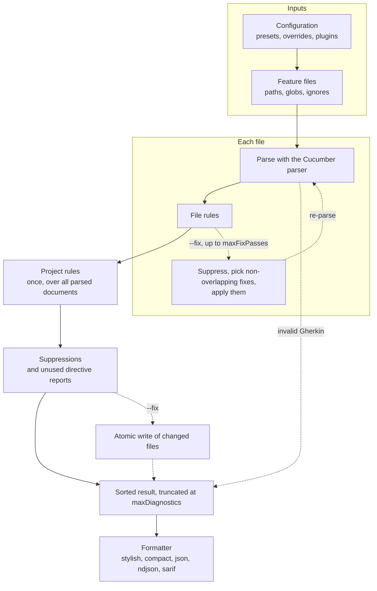

# Architecture

Solid arrows are every run. Dashed arrows only happen with `--fix`, `--fix-dry-run` or invalid Gherkin.

| Stage | Source |
| --- | --- |
| Configuration and plugins | `src/config/index.ts`, `src/config/plugins.ts` |
| File discovery | `src/core/files.ts` |
| Orchestration, writes and result | `src/core/engine.ts` |
| Parsing and traversal helpers | `src/parser/document.ts` |
| File rules and fix passes | `src/core/process-file.ts`, `src/core/rule-execution.ts`, `src/core/fixes.ts` |
| Project rules | `src/core/rule-execution.ts` |
| Suppressions | `src/core/suppressions.ts` |
| Formatters | `src/formatters/index.ts` |
| Built-in rules | `src/rules/core/` for native rules, `src/rules/legacy/` for gherkin-lint rules |

`LintDocument` keeps original text, line starts, normalized paths, and the Cucumber AST. Traversal helpers visit Scenarios both directly under Feature and under Rule.

Files go through parsing, file rules and fix passes independently, up to `maxConcurrency` at once. A file with invalid Gherkin reports `parsing-error` and skips its rules. File rules receive one document and an immutable context. Project rules run once after every file finishes, with all parsed documents; see [project rules](plugins.md#project-rules) for how they read options and severity. Async rule execution is awaited. Rule failures are execution errors with rule, plugin, and file information.

Fixes are source ranges. With `--fix`, each pass drops suppressed diagnostics, rejects overlapping edits, applies the rest from the end of the source, and parses the result again, for at most `maxFixPasses` passes. A fix that produces invalid Gherkin stops the run without writing any file. `--fix-dry-run` reports the fixes of a single pass and writes nothing. Only file rules can fix: the engine drops a fix reported by a project rule. Each file is written to a temporary file in the same directory and renamed over the original. Files are written one after another, so if a later write fails, the files written before it keep their fixes.

Formatters consume completed results. They do not run rules, mutate diagnostics, or write files. JSON and NDJSON contain no timestamps or terminal escape codes.
